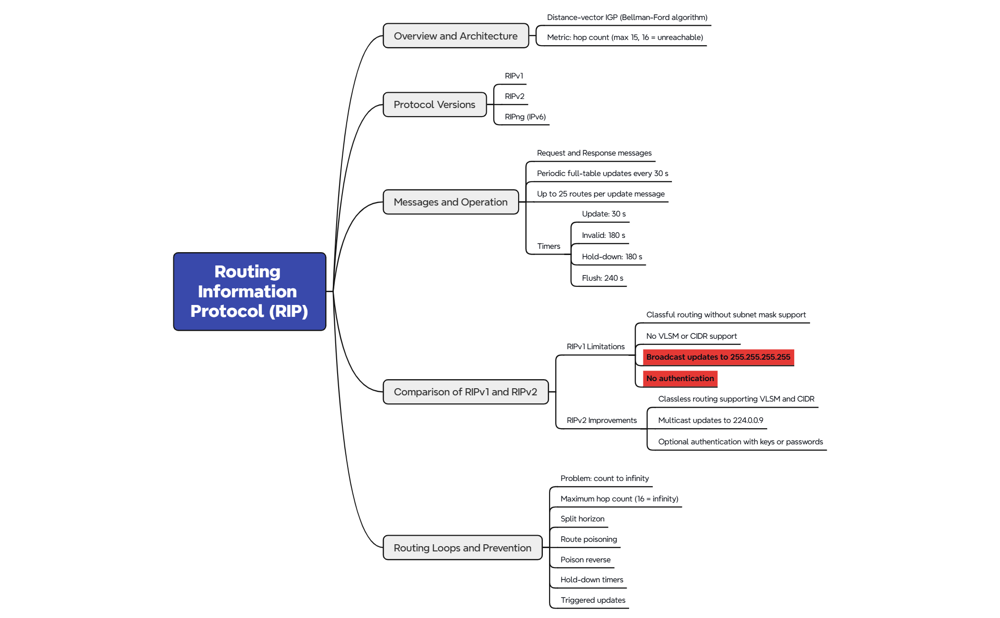

# RIPv2 Lab on Cisco Packet Tracer

Four routers in a ring, four LANs, dynamic routing with RIP version 2.
The lab starts from isolated routing tables and ends with full reachability between every LAN.

## Repository content

| File | Description |
|---|---|
| `RIP LAB.pkt` | Packet Tracer topology, fully configured |
| `RIPv2_Lab_Carousel.pdf` | Visual summary of the lab |
| `Routing Information Protocol (RIP).xmind` | Mind map of RIP theory (outline below) |
| `RIP_Mindmap.png` | Mind map exported as an image |

## Topology

| Router | Interface | IP address | Connects |
|---|---|---|---|
| R1 | G0/0 | 192.168.1.1/30 | to R2 |
| R1 | G0/1 | 192.168.4.1/30 | to R4 |
| R1 | G0/2 | 172.16.10.1/24 | LAN PC0 |
| R2 | G0/0 | 192.168.1.2/30 | to R1 |
| R2 | G0/1 | 192.168.2.1/30 | to R3 |
| R2 | G0/2 | 172.16.20.1/24 | LAN PC1 |
| R3 | G0/0 | 192.168.2.2/30 | to R2 |
| R3 | G0/1 | 192.168.3.2/30 | to R4 |
| R3 | G0/2 | 172.16.30.1/24 | LAN PC3 |
| R4 | G0/0 | 192.168.3.1/30 | to R3 |
| R4 | G0/1 | 192.168.4.2/30 | to R1 |
| R4 | G0/2 | 172.16.40.1/24 | LAN PC2 |

Each PC uses the `.2` address of its LAN, with the router `.1` address as default gateway.

## Configuration

Same structure on every router, only the `network` statements change.

```
router rip
 version 2
 no auto-summary
 network <transit link 1>
 network <transit link 2>
 network <local LAN>
 passive-interface g0/2
```

| Router | Networks |
|---|---|
| R1 | 192.168.1.0, 192.168.4.0, 172.16.10.0 |
| R2 | 192.168.1.0, 192.168.2.0, 172.16.20.0 |
| R3 | 192.168.2.0, 192.168.3.0, 172.16.30.0 |
| R4 | 192.168.4.0, 192.168.3.0, 172.16.40.0 |

## Verification

```
show ip route          # routes learned by RIP are marked R
show ip protocols      # RIP version, networks, passive interfaces
ping 172.16.20.2       # from PC0 to PC1
tracert 172.16.20.2    # path: R1, R2, PC1
```

## Security notes

No authentication is configured in this lab. Any device speaking RIP on a transit link could inject false routes.
`passive-interface` stops updates toward the LANs but is not a defence on its own.

Next steps: MD5 authentication with a key chain, then the same topology with OSPF.

## RIP mind map



Source file: `Routing Information Protocol (RIP).xmind` (open with XMind).

---
Adam Belbaraka
